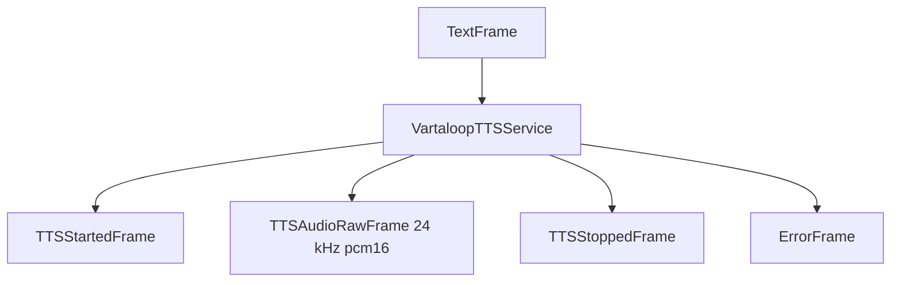

## Overview

`VartaloopTTSService` converts text to speech with [Vartaloop](https://vartaloop.ai), a Hinglish and Indian-language
TTS API, over one WebSocket per session. Every sentence of a turn is sent as its own utterance as soon as it is
aggregated; the server serves them in order and streams each one's 24 kHz PCM back from its first 80 ms frame.
`VartaloopHttpTTSService` does the same over HTTP, one request per sentence.

<CardGroup cols={3}>
  <Card title="API Reference" icon="code" href="https://docs.pipecat.ai/api-reference/server/services/tts/vartaloop">
    Pipecat's API methods and parameters
  </Card>
  <Card title="Vartaloop Docs" icon="book" href="https://docs.vartaloop.ai">
    Voices, normalisation and the API
  </Card>
  <Card title="Example Code" icon="play" href="https://github.com/pipecat-ai/pipecat/blob/main/examples/voice/voice-vartaloop.py">
    A Hinglish voice agent
  </Card>
</CardGroup>

## Installation

```bash
uv add "pipecat-ai[vartaloop]"
```

You'll need an API key from the [Vartaloop portal](https://tts.vartaloop.ai), set as `VARTALOOP_API_KEY`.

## Configuration

### Constructor parameters

<ParamField path="api_key" type="str" required>
  The Vartaloop API key (`vt_live_…`). Read from `VARTALOOP_API_KEY` when not given.
</ParamField>
<ParamField path="url" type="str" default="wss://api.vartaloop.ai/v1/tts/stream">
  The WebSocket endpoint (`VartaloopTTSService`). `VartaloopHttpTTSService` takes `base_url`.
</ParamField>
<ParamField path="sample_rate" type="int" default="None">
  Output sample rate. The API produces 24 kHz; audio is resampled when the pipeline runs at another rate.
</ParamField>
<ParamField path="settings" type="VartaloopTTSService.Settings">
  Runtime-updatable settings, see below.
</ParamField>

### Settings

<ParamField path="voice" type="str" default="saanvi">
  Voice id; `GET /v1/voices` lists them. The voice decides the language and so the text normaliser.
</ParamField>
<ParamField path="expression" type="str" default="neutral">
  Delivery: `neutral`, `excited`, `sad`, `whisper` (alias `style`). A voice without the expression plays neutral.
</ParamField>
<ParamField path="digits" type="str" default="auto">
  How digits are read in Hinglish text: `hi`, `mixed`, `en` or `auto`.
</ParamField>
<ParamField path="speed" type="float" default="None">
  Speaking pace 0.5–2.0, pitch preserved (alias `pace`).
</ParamField>
<ParamField path="temperature" type="float" default="None">Sampling noise 0–2 (server default 0.3).</ParamField>
<ParamField path="seed" type="int" default="None">Fixed sampling seed.</ParamField>
<ParamField path="postfx" type="bool" default="None">The server's loudness / high-pass / limiter chain (default on).</ParamField>
<ParamField path="profile" type="str" default="None">`default` or `telephony` (shaped for 8 kHz mu-law).</ParamField>
<ParamField path="raw" type="bool" default="False">Skip the server's text normaliser.</ParamField>

## Usage example

```python
from pipecat.services.vartaloop.tts import VartaloopTTSService

tts = VartaloopTTSService(
    api_key=os.getenv("VARTALOOP_API_KEY"),
    settings=VartaloopTTSService.Settings(voice="saanvi", digits="auto"),
)

pipeline = Pipeline([
    transport.input(),
    stt,
    user_aggregator,
    llm,
    tts,
    transport.output(),
    assistant_aggregator,
])
```

Change any setting mid-call with `TTSUpdateSettingsFrame(delta=VartaloopTTSService.Settings(expression="excited"))`; it
applies from the next sentence without reconnecting.

## Frame flow



## Metrics

Time to first byte (stopped on the server's `first_audio_ms` event), usage characters per utterance.
